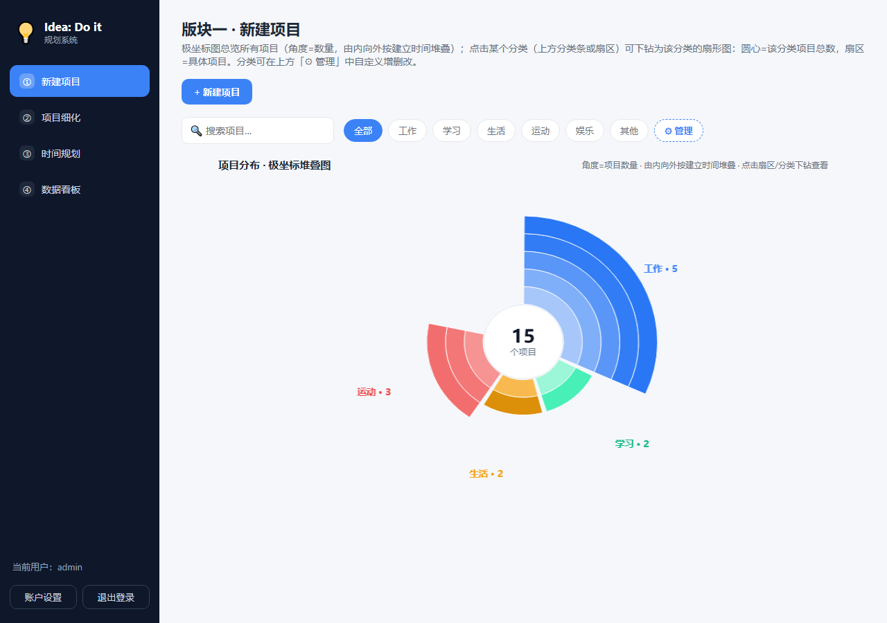
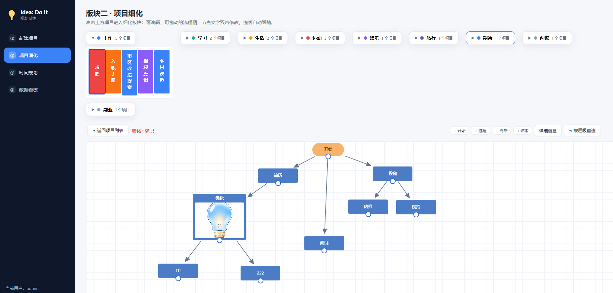
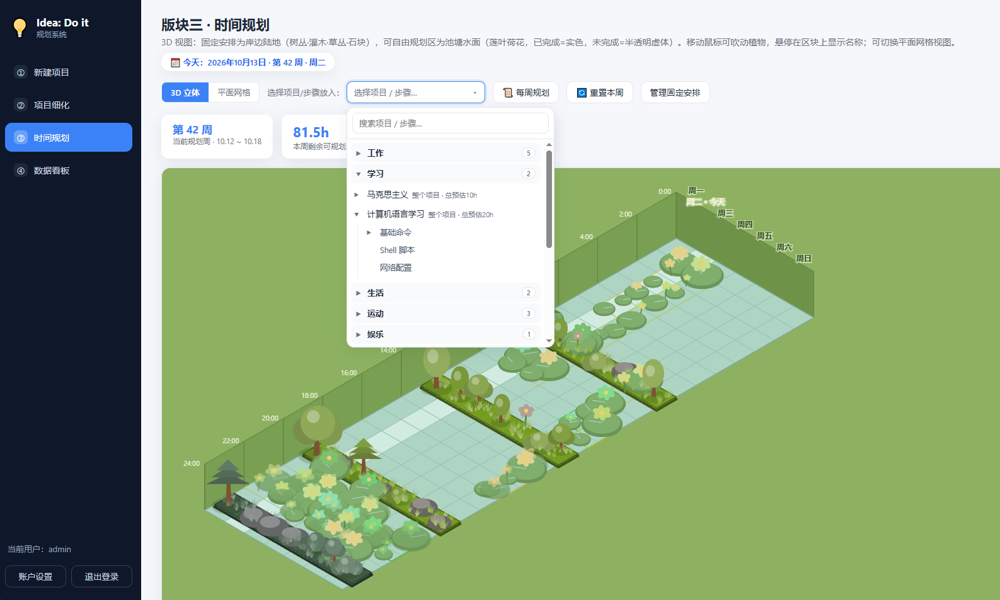
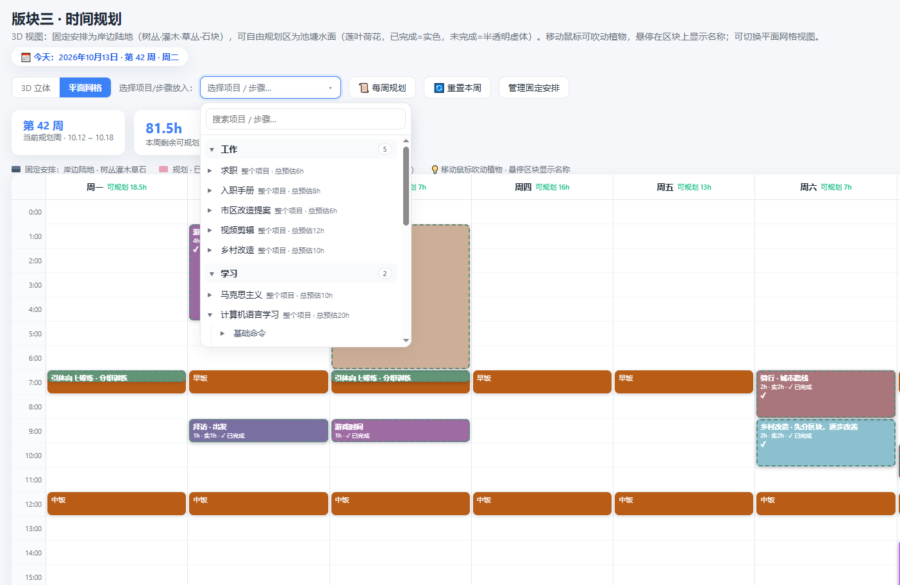
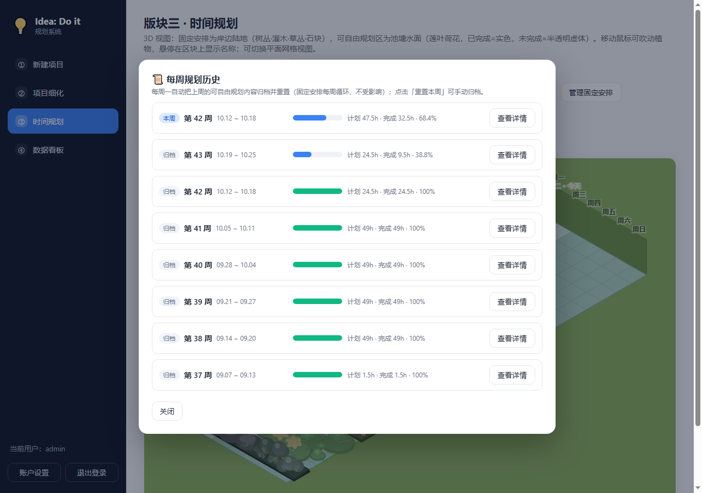
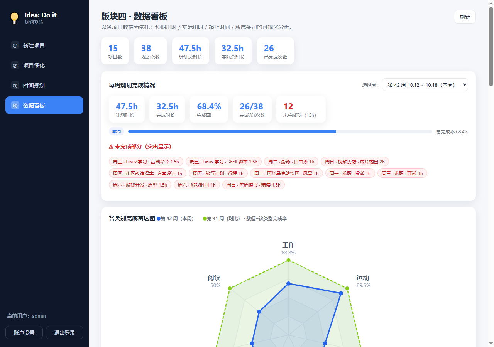

# 💡 Idea: Do it · 个人规划系统

一个轻量、可视化的个人项目 / 学习 / 时间规划系统。把“想法”放进四个递进版块里：新建项目 → 项目细化 → 时间规划 → 数据看板，帮助你从灵感落地到持续复盘。

> 默认体验账号：`admin` / `admin123`（仅用于本地和演示数据，首次部署后请立即修改）。


---

## 主要功能

| 版块             | 作用                | 亮点                      |
| -------------- | ----------------- | ----------------------- |
| **版块一 · 新建项目** | 管理项目、分类、预期投入      | 极坐标堆叠图：按分类下钻，项目分布一目了然   |
| **版块二 · 项目细化** | 把项目拆成步骤，画成流程图     | 节点双击编辑、可拖拽、父子步骤自动关联     |
| **版块三 · 时间规划** | 把步骤放到每周日程         | 3D 池塘视图 + 平面网格；历史周报自动归档 |
| **版块四 · 数据看板** | 完成率 / 投入时长 / 类别对比 | 雷达图、柱状图、明细表，支持按周选择      |
| **账户设置**       | 修改账户名、密码          | 登录页灯泡动效：成功变蓝亮，失败闪红并抖动   |

---

## 截图一览

### 1. 项目分布（版块一）

按分类堆叠的极坐标图，点击分类或扇区可下钻。



### 2. 项目细化（版块二）

项目按分类卡片展示，进入单个项目即可编辑流程图。



流程节点支持双击修改、批量对齐、层级重连：

### 3. 时间规划（版块三）

3D 视图：岸边陆地为固定作息，池塘水面为本周计划，已完成 / 未完成用不同透明度区分。



选择项目 / 步骤时支持多级折叠，分类 → 项目 → 父子步骤：



### 4. 每周规划历史

每周一自动归档上周计划，连续几周的数据可回看。



### 5. 数据看板（版块四）

按周统计计划时长、完成率、类别雷达图、项目投入对比。



---

## 技术栈

- 后端：Python 3.10+ / Flask / Flask-SQLAlchemy / SQLite
- 前端：原生 JS（IIFE）/ Canvas 2D / SVG
- 部署：Docker / Docker Compose（可在飞牛 fnOS、NAS、云服务器等环境运行）
- 可选：离线 wheels（`wheels/` 目录），方便无网环境安装

---

## 项目结构

```text
Idea Do it/
├── app.py                 # Flask 入口
├── requirements.txt       # Python 依赖
├── Dockerfile / docker-compose.yml / .dockerignore
├── templates/             # HTML 模板
├── static/                # JS、CSS、图标、灯泡素材
│   ├── app.js
│   ├── style.css
│   ├── favicon.ico
│   └── bulb.png
├── wheels/                # 离线 whl（可选）
├── sample_data/           # 示例 SQLite 数据库
│   └── app.db              # 15 项目 / 6 周数据 / 固定作息
└── screenshots/           # README 与演示视频截图
```
